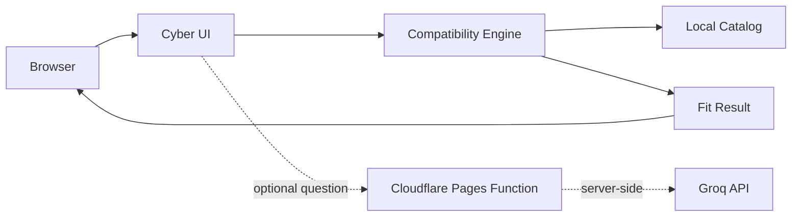

<div align="center">

# ⚡ CAN MY DEVICE RUN IT // COMPATIBILITY CONSOLE

**Hardware intelligence for the device you already own.**

[](https://canmydevicerunit.pages.dev)
[](https://github.com/menacing-aura/CanMyDeviceRunIt/actions/workflows/ci.yml)


### [▶ LAUNCH THE LIVE SITE](https://canmydevicerunit.pages.dev)

`https://canmydevicerunit.pages.dev`

</div>

---

```text
╭──────────────────────────────────────────────────────╮
│  SYS://CAN-MY-DEVICE-RUN-IT                         │
│                                                      │
│  STATUS ............... ONLINE                       │
│  DEVICES .............. 19                           │
│  GAMES ................ 8                            │
│  APPS ................. 12                           │
│  DEPLOY TARGET ........ CLOUDFLARE PAGES             │
│  RUNTIME .............. NODE 22+                     │
│  MODE ................. NO ACCOUNT / NO SCANNER      │
╰──────────────────────────────────────────────────────╯
```

## `01 // WHAT IT DOES`

**CanMyDeviceRunIt** compares a real device configuration against published game and application requirements.

Pick a listed PC, Mac, Android phone, or Chromebook, or enter your own specs. The compatibility engine checks platform support, CPU/GPU capability tiers, RAM, architecture, OS version when known, and available storage when supplied.

The result is deliberately transparent: **good hardware fit, minimum specs met, below requirements, unsupported platform, or more information needed**.

> No fake FPS predictions. No magic hardware scan. No account required.

## `02 // LIVE DEPLOYMENT`

| Channel | Status |
| --- | --- |
| **Production** | 🟢 Online |
| **URL** | **[canmydevicerunit.pages.dev](https://canmydevicerunit.pages.dev)** |
| **Host** | Cloudflare Pages |
| **Production branch** | `main` |
| **Build command** | `npm run build` |
| **Output** | `dist/` |
| **Runtime** | Node.js 22+ |
| **CI** | GitHub Actions |

Every push to `main` is checked by GitHub Actions and is connected to the Cloudflare Pages production deployment.

```text
GITHUB PUSH
    │
    ▼
┌───────────────┐
│  CI / VERIFY  │  npm ci + npm run check
└───────┬───────┘
        │ green
        ▼
┌───────────────────┐
│ CLOUDFLARE PAGES  │
└─────────┬─────────┘
          │
          ▼
   GLOBAL EDGE DEPLOY
          │
          ▼
 canmydevicerunit.pages.dev
```

## `03 // COMPATIBILITY CORE`

The checker evaluates:

- **Operating system / native platform support**
- **CPU capability**
- **GPU capability**
- **RAM**
- **CPU architecture**
- **App runtime architecture** where relevant
- **OS version** when supplied
- **Available storage** when supplied
- **Recommended hardware headroom**
- **Alternative compatible games/apps**

The fit index is an editorial ruleset, **not a benchmark, FPS estimate, probability, or performance guarantee**.

| Fit index | Meaning |
| ---: | --- |
| `95` | Checked hardware has headroom |
| `75` | Checked minimum hardware is met |
| `35` | At least one checked requirement fails |
| `—` | Unsupported or not enough verified data |

## `04 // CURRENT CATALOG`

### Devices // `19`

The starter database includes explicit configurations across:

`Windows` · `macOS` · `Android` · `ChromeOS`

Examples include gaming laptops, everyday/business laptops, MacBook Air models, Pixel phones, Galaxy phones, Chromebook Plus systems, and the original Chromebook Duet.

### Software // `20 titles`

**8 games**
- Fortnite
- Minecraft: Java Edition
- Minecraft: Bedrock Edition
- Roblox
- Genshin Impact
- Stardew Valley
- Counter-Strike 2
- VALORANT

**12 apps**
- Blender
- Visual Studio Code
- Discord
- Spotify
- OBS Studio
- GIMP
- Krita
- Godot Engine
- Android Studio
- Docker Desktop
- Adobe Photoshop
- Adobe Premiere

Catalog facts and source links live in `src/catalog.js`. The current source snapshot is reviewed manually rather than silently auto-updating.

## `05 // ARCHITECTURE`



### Core files

| Path | Purpose |
| --- | --- |
| `src/app.js` | UI, navigation, dialogs, state, rendering |
| `src/styles.css` | Main cyber-tech interface |
| `src/catalog.js` | Devices, games, apps, requirements, sources |
| `src/compatibility.js` | Compatibility rules and alternatives |
| `functions/api/assistant.js` | Optional server-side AI explanation endpoint |
| `scripts/build.js` | Static production build and generated routes |
| `tests/` | Compatibility, UI, endpoint, build, and security tests |

## `06 // PRIVACY MODE`

The project is designed to work without collecting an account profile.

- No user account required
- No hardware scanner
- No analytics database in this project
- Selected/custom device details stay in browser storage
- Custom specs are not placed in share URLs
- Compatibility calculations run in the browser

If the optional AI helper is used, the question plus relevant comparison context is sent through the Cloudflare Pages Function to the configured Groq endpoint. The API key remains server-side.

## `07 // LOCAL BOOT SEQUENCE`

Requires **Node.js 22+**.

```bash
git clone https://github.com/menacing-aura/CanMyDeviceRunIt.git
cd CanMyDeviceRunIt
npm ci
npm run dev
```

Open:

```text
http://localhost:5173
```

### Full verification

```bash
npm run check
```

That runs syntax checks, the test suite, and a production build.

Useful commands:

```bash
npm test
npm run build
npm run preview
npm run cf:dev
```

For local Pages Function testing, copy `.dev.vars.example` to `.dev.vars` and add your own `GROQ_API_KEY`. Never commit secrets.

## `08 // CLOUDFLARE CONFIG`

The production project is already deployed to Cloudflare Pages.

| Setting | Value |
| --- | --- |
| Project name | `canmydevicerunit` |
| Production URL | `https://canmydevicerunit.pages.dev` |
| Framework preset | None |
| Production branch | `main` |
| Build command | `npm run build` |
| Output directory | `dist` |
| Root directory | `/` |
| Node | `22+` |

The root `functions/` directory contains the Pages Function for `/api/assistant`. If the optional helper is enabled, configure `GROQ_API_KEY` as an encrypted Cloudflare secret, never as browser code or a committed variable.

`GROQ_MODEL` is non-secret configuration and defaults to `openai/gpt-oss-120b`.

## `09 // DATA INTEGRITY`

Requirements are sourced from publisher/manufacturer pages and stored as explicit catalog snapshots.

Important limitations:

- CPU/GPU scores are broad editorial capability tiers, not measured benchmarks.
- Total drive capacity never counts as free storage.
- Unknown requirements remain unknown.
- Driver support, firmware, anti-cheat, store availability, thermals, power limits, mods, project complexity, and individual hardware variants can change the real result.
- Cloud streaming, emulation, browser editions, Linux containers, and older unsupported releases are separate from native compatibility checks.

## `10 // CI GUARDRAILS`

GitHub Actions runs on pushes and pull requests using Node.js 22.

The verification pipeline checks:

```text
JS SYNTAX
   ├── APP
   ├── CATALOG
   ├── COMPATIBILITY ENGINE
   └── ASSISTANT FUNCTION

TEST SUITE
   ├── COMPATIBILITY RULES
   ├── STORAGE SAFETY
   ├── PLATFORM / ARCHITECTURE LOGIC
   ├── CATALOG SOURCES
   ├── UI CONSISTENCY
   ├── BUILD OUTPUT
   └── ENDPOINT / FILE ACCESS SAFETY

PRODUCTION BUILD
   └── dist/
```

## `11 // ASSETS + TRADEMARKS`

Artwork and trademarks remain the property of their respective owners. Image/source notes are documented in `public/assets/ASSETS.md`.

CanMyDeviceRunIt is an independent compatibility guide and does not imply endorsement by hardware manufacturers, game publishers, software vendors, Cloudflare, or Groq.

---

<div align="center">

### `SYS://READY`

**Pick a device. Pick a game or app. Get a clearer answer before the download starts.**

[](https://canmydevicerunit.pages.dev)

<sub>Built with JavaScript · Cloudflare Pages · GitHub Actions · unreasonable amounts of cyan</sub>

</div>
